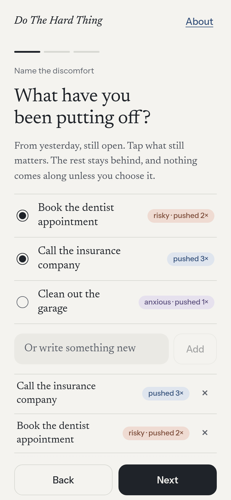
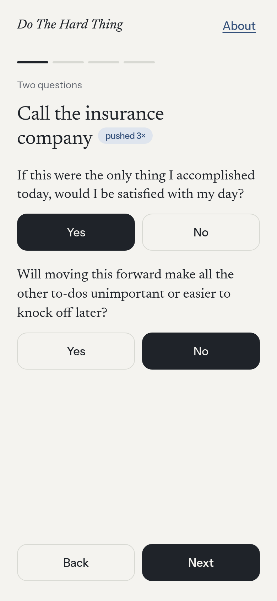
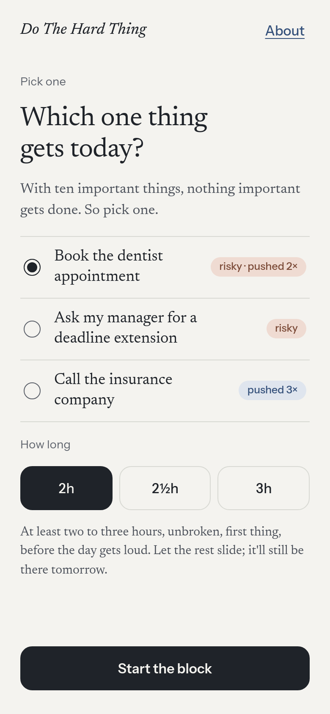
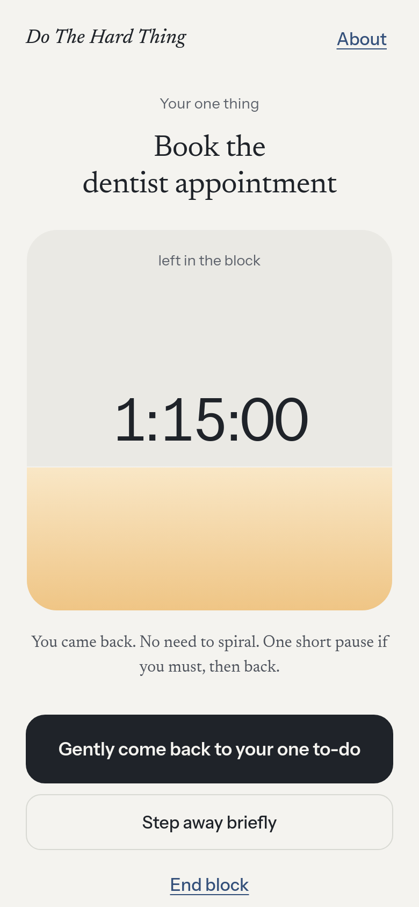

# Do The Hard Thing

[](https://github.com/Queen-City-Cortex/DoTheHardThing/actions/workflows/ci.yml)

**Live at [DoTheHardThing.app](https://dothehardthing.app).**

A morning method, as an offline-first PWA: name what you have been avoiding, ask two questions, pick one thing, and protect one unbroken block of two to three hours to do it. No account, no streaks, nothing you write ever leaves your device.

| Name it | Two questions | Pick one | Protect the block |
| --- | --- | --- | --- |
|  |  |  |  |

More screens (close the day, About, a returning bad day, dark mode) are in [`docs/screenshots/`](docs/screenshots/).

## Features

- **Name what is uncomfortable.** Three short prompts (what you keep putting off, what could get you rejected or start a conflict, what is making you anxious). Up to five items. One item can answer more than one prompt.
- **Two questions, then pick one.** For each item: would finishing it alone leave you satisfied with the day, and would it make the other to-dos unimportant or easier? Then choose the one thing for today.
- **Protect one block.** A 2, 2.5 or 3 hour countdown. One short step-away (under 10 minutes) is allowed; 10 minutes or more ends the block.
- **Close the day.** "Did you do it?" is your own answer, Yes or Not today. There is no scoring.
- **Your days.** A quiet history of the days you finished, with a count that only goes up.
- **Gentle on bad days.** Returning after missed days or starting late (11:00 or later) lets you choose a shorter, modified block instead of a guilt trip.
- **Optional morning reminder** through the browser's notifications, if you allow them.
- **Works offline and installs** to your home screen (service worker and web manifest). Light and dark themes follow your device.

## Quick start

You need Node 22 (see `.nvmrc`).

```bash
npm ci
npm run dev        # http://localhost:5173
```

## Test, lint, build

```bash
npm run check      # the test, lint, build and dist steps below in one command (plus typecheck, a public hygiene check and the AGENTS.md check), as CI runs it
npm test           # Vitest: app logic, storage, reminders, contrast, analytics client, the Worker
npm run lint       # ESLint
npm run build      # tsc -b && vite build -> ./dist
npm run check:dist # after a build: the service worker precaches every file the page loads, and the app shell gets no-cache headers
npm run preview    # serve ./dist locally (http://127.0.0.1:4173)
```

End-to-end journeys (headless Chromium against a production build) live in [`e2e/`](e2e/README.md): `npm run build && npm run journeys`. To retake the screenshots in `docs/screenshots/`, start `npm run preview` and run `node scripts/screens.mjs` (set `CHROMIUM_PATH` to use your own Chromium).

## Deploy

The app deploys as one Cloudflare Worker with static assets, using [Wrangler](https://developers.cloudflare.com/workers/wrangler/):

```bash
npm run build && npx wrangler deploy
```

`wrangler.jsonc` serves `./dist` as static assets, and requests to `/api/*` run the Worker (`worker/index.ts`) first; everything else is served from `./dist`.

Wrangler is not a project dependency. CI pins it with `WRANGLER_VERSION` in `.github/workflows/ci.yml`; a manual deploy uses whatever version `npx` fetches.

### Automatic deploy

Every push to `master` runs [`.github/workflows/ci.yml`](.github/workflows/ci.yml). Its `check` job runs `npm run check` (typecheck, lint, tests, build, `check:dist`, a public hygiene check, the AGENTS.md check and `check:workflows`, which fails when the workflow loses one of the properties in this paragraph). It also runs a deploy preflight, `wrangler deploy --dry-run`, which needs no credentials. Its `journeys` job then runs the end-to-end journeys against the build: 8 of them on a pull request, all of them on `master`. When `check` and `journeys` both pass, the `deploy` job (environment `production`) builds again and runs `wrangler deploy`, then runs `npm run verify:live`, which only reads `https://dothehardthing.app` (GET requests, nothing is posted): the page is 200 and serves the new build's entry script, `GET /api/event` answers 405 from the Worker, and `og-image.png` and `sw.js` equal this build's. Pull requests and forks never deploy. Deploys are serialised (concurrency group `deploy-production`), the job has `contents: read` only, actions are pinned to commit SHAs, and Node comes from `.nvmrc`. Merging to `master` therefore deploys the site.

**Before the first deploy** (the preflight cannot see these; a real deploy fails without them):

- Analytics Engine is enabled on the Cloudflare account (Analytics Engine in the Cloudflare dashboard). The `EVENTS` binding in `wrangler.jsonc` fails with error 10089 otherwise.
- The two GitHub secrets below exist and the API token has the permissions below.
- The GitHub environment `production` needs no setup: GitHub creates it the first time the deploy job runs. Adding a required reviewer to it in the repository settings (Settings > Environments) would make every deploy wait for an approval.

**GitHub secrets** (repository **Settings > Secrets and variables > Actions > Repository secrets > New repository secret**):

| Name | Value |
| --- | --- |
| `CLOUDFLARE_API_TOKEN` | A custom API token with only the permissions below |
| `CLOUDFLARE_ACCOUNT_ID` | The Cloudflare account id (dashboard > Workers & Pages overview, right sidebar) |

Nothing else is stored in the repository: `wrangler.jsonc` has no account id.

**API token** (Cloudflare dashboard > My Profile > API Tokens > Create Token > Create Custom Token). What `wrangler deploy` needs for this project:

| Resource | Permission | Why |
| --- | --- | --- |
| Account > Workers Scripts | Edit | Uploads the Worker script, its static assets and its bindings, including the `EVENTS` Analytics Engine binding (no separate permission is needed to declare a binding) |
| Zone > Workers Routes | Edit (shown as Write in some places) | Attaches the custom domains `dothehardthing.app` and `www.dothehardthing.app` (`routes` with `custom_domain: true`) |
| Zone > Zone | Read | Wrangler looks the zone up by hostname |

Scope the account resource to this account only and the zone resource to the `dothehardthing.app` zone only. Not needed: Account Analytics Read (that is only for querying the counts, not for deploying), DNS Edit (Cloudflare creates the Custom Domain records itself), and Memberships Read (the account id is given, so Wrangler does not have to discover it). Creating a brand-new Worker would need the Workers Admin role, but this Worker already exists. Analytics Engine must also be enabled on the account: see "Before the first deploy" above. If a deploy fails with a permissions error, the failing API call is in the Wrangler output; add only what it names.

**Roll back.** Either:

- Cloudflare side, fastest: `npx wrangler rollback` (pick a version; or `npx wrangler rollback <version-id>`) puts a previous Worker version, assets included, back live. Run it with `CLOUDFLARE_API_TOKEN` and `CLOUDFLARE_ACCOUNT_ID` set, or in the dashboard under the Worker's **Deployments**.
- Git side: revert the bad commit on `master` (`git revert <sha>` and push or open a PR). CI redeploys the reverted tree. To redeploy an older commit by hand: check it out, then `npm ci && npm run build && npx wrangler deploy`.

A rollback done on the Cloudflare side is overwritten by the next push to `master`, so revert the commit as well.

**If you fork this**, the checked-in config is the original site's, so before deploying:

- Change `name` in `wrangler.jsonc` (it is `dothehardthing`) and replace or remove the `routes` entries for `dothehardthing.app`. Without routes the Worker is served from your own `workers.dev` address.
- Deploy to your own Cloudflare account (`npx wrangler login`).
- Update the Open Graph and Twitter URLs in `index.html` (and `public/og-image.png` if you want your own card) and the `homepage`, `repository` and `bugs` fields in `package.json`.
- Optionally set up the analytics described below, or leave it out (the app works without it).

## Architecture

A Vite + React + TypeScript PWA (`src/`), served by a Cloudflare Worker (`worker/`) whose only code path accepts anonymous event counts; the static files come from its assets binding. The app is local-first: its data is one JSON value in `localStorage` (plus a small key that records which counts were sent today). See [docs/architecture.md](docs/architecture.md).

## Privacy

- What you write (items and answers) stays in your browser's `localStorage` on your device. It is never sent anywhere, and there is no account or sync.
- The app sends three anonymous counts to its own Worker (`started`, `finished`, `opened_history`), at most once per browser per day, with no text, id or cookie. The Worker stores the event name and a country code. Details are in [Analytics](#analytics) below.
- None of the three counts is sent when your browser sends Do Not Track or Global Privacy Control, and none is sent in development builds. The optional Cloudflare beacon below does not read those signals.
- The optional Cloudflare Web Analytics script is included only when a build sets `VITE_CF_ANALYTICS_TOKEN`; it is cookie-free.

## Principles

- **No streaks, no gamification.** No points, badges, levels or leaderboards. A missed day adds nothing and resets nothing; the count of finished days only goes up.
- **One thing.** The method is deliberately small: one thing, one block.
- **Calm and honest.** No guilt, no nagging. The reminder says so when it cannot work (for example, when notifications are blocked).
- **Your data stays yours.** Local-first, no account.

## Credit

The method is Tim Ferriss's: his morning approach to efficacy (doing the right thing, rather than efficiency), condensed here from eight steps to three. See [his post on X](https://x.com/tferriss/status/2110445158206447830), which links the short talk.

Do The Hard Thing is an independent project. It is not affiliated with or endorsed by Tim Ferriss. The one-pause allowance inside a block and the shorter block offered after missed days or a late start are this app's own additions, not part of his method.

## Contributing

See [CONTRIBUTING.md](CONTRIBUTING.md).

## License

[MIT](LICENSE) © 2026 Jeffery Hoffman (Queen City Cortex).

## Social preview

`index.html` carries Open Graph and Twitter card tags pointing at `https://dothehardthing.app/og-image.png` (1200×630, `public/og-image.png`, about 110 KB). The image shows the title, tagline, `DoTheHardThing.app` and a phone showing the Pick screen. The phone is a real screenshot of the app's Pick screen, so rebuild the image when that screen's look or copy changes: `npm run build`, `npx vite preview --port 4173`, then `node scripts/og/card.mjs` (set `OG_URL` or `OG_OUT` to change the app address or the output file). It needs Playwright's Chromium (`npx playwright install chromium`). Look at the image before committing it. If you fork, edit the title, tagline and URL in `scripts/og/card.mjs` too.

## Analytics

Two cookie-free pieces. Neither ever sees what you write. The About page says what is collected.

### 1. Visits: Cloudflare Web Analytics (optional beacon)

Page views, referrers (for example, how many came from a tweet) and countries.

1. Cloudflare dashboard > **Analytics & Logs** > **Web Analytics** > **Add a site**.
2. Choose the hostname `dothehardthing.app`. Cloudflare shows a JavaScript snippet; copy the `token` from `data-cf-beacon='{"token": "..."}'`. (Do not paste the snippet into the code.)
3. Build with the token set, then deploy:

   ```bash
   VITE_CF_ANALYTICS_TOKEN=<token> npm run build && npx wrangler deploy
   ```

   Or put `VITE_CF_ANALYTICS_TOKEN=<token>` in a git-ignored `.env.production.local` file and run the usual deploy command.

Without the variable, the build contains no Cloudflare script at all, so nothing ships broken. The token is not a secret (it is visible in the page), but it stays out of git anyway.

### 2. Finished days: anonymous event counts (Workers Analytics Engine)

Cloudflare Web Analytics cannot count custom events, so the app sends three counts to its own Worker, which writes them to Workers Analytics Engine:

| event | when |
| --- | --- |
| `started` | the Name screen (step 1 of 3) opens (once per browser per day) |
| `finished` | "Did you do it?" is answered Yes (once per browser per day) |
| `opened_history` | Your days is opened (once per browser per day) |

- The request is `POST /api/event` with the body `{"event":"started"}`. Nothing else is sent: no item text, no stored data, no id, no cookie. The Worker stores the event name and a country code from Cloudflare's own request metadata; it does not store IPs or user agents.
- Off in development. Off when the browser sends Do Not Track or Global Privacy Control. Silent when offline or blocked; nothing is retried.
- Client: `src/analytics.ts`. Worker: `worker/index.ts`. Binding: `analytics_engine_datasets` in `wrangler.jsonc` (binding `EVENTS`, dataset `dothehardthing_events`). The dataset is created on the first write; there is nothing to set up by hand. If the deploy complains that Analytics Engine is not enabled, open Cloudflare dashboard > **Workers & Pages** > **Analytics Engine** once and enable it.

Reading the counts, with an API token that has the **Account Analytics: Read** permission (`curl` or Grafana):

```sql
SELECT blob1 AS event, toDate(timestamp) AS day, SUM(_sample_interval) AS count
FROM dothehardthing_events
GROUP BY event, day
ORDER BY day DESC, event
```

```bash
curl "https://api.cloudflare.com/client/v4/accounts/<account_id>/analytics_engine/sql" \
  -H "Authorization: Bearer <api_token>" --data "<the query above>"
```

Because each event is counted once per browser per day, `finished` divided by `started` over a day or week is a rough "how many who began got to Yes" figure. A day left unfinished carries over to the next date, so it is only meaningful over a week or more.
